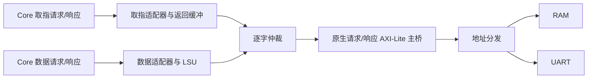

# AXI4-Lite 访存路径优化记录

2026-10-21：CoreMark 同一测量区间的 CPI 从 **8.3503 降到 2.0672**，周期减少 **75.24%**，相同时钟下该区间约加速 **4.04 倍**。RAM 和 UART 仍是并列的 AXI4-Lite 从设备，所有 CPU RAM 访问继续经过 AXI。此次优化减少控制交接空拍，尚未增加 Cache、MMU 或 AXI4 突发。

## 性能比较

使用相同工具链、CoreMark 一次迭代、不注入测试等待，比较 `start_time` 到 `stop_time` 的 `[PERF-REGION]`。`minstret` 保持一致，CRC 与计数器一致性校验均通过。

| 版本 | mcycle | minstret | CPI |
| --- | ---: | ---: | ---: |
| P1 本地 RAM，接入共享 AXI 前 | 686309 | 287265 | 2.3891 |
| 共享 AXI RAM，优化前 | 2398761 | 287265 | 8.3503 |
| 简化主桥和 RAM 返回，尚未优化 Core 取指交接 | 837174 | 287265 | 2.9143 |
| 本次最终版本 | 593825 | 287265 | **2.0672** |

证据：[P1 基线](../test_results/coremark_summary_20261021_105509_440290.txt)、[共享 AXI 基线](../test_results/coremark_summary_20261021_110950_219933.txt)、[中间版本](../test_results/coremark_summary_20261021_121531_029169.txt)、[最终版本](../test_results/coremark_summary_20261021_122919_503847.txt)。最终版本相比 P1 也减少约 13.48% 的周期。一次迭代仅用于短程比较，不满足 CoreMark 正式分数的运行时长要求。

不要使用仿真结束时的全程 `[PERF]` 代替这个区间。全程还包括初始化和 UART 输出，其等待时间与基准计算不同。

## 当前结构与修改



| 文件 | 本次变化及原因 |
| --- | --- |
| `vsrc/bus/axi_lite_master.v` | 新主桥直接接收逐字请求；空闲时直接送出 AXI 通道，背压时保存字段，AW/W 分别跟踪；避免原先请求/响应与启动/busy 之间的两层转换 |
| `vsrc/top.v` | 删除取指入口和主桥入口的冗余 `mem_req_adapter` 实例，改接原生主桥；数据侧仍保留适配器与 LSU |
| `vsrc/bus/fetch_mem_adapter.v` | 改为原生握手，保存请求 ID；返回可直接传递，Core 不接收时存入一项缓冲并释放后备总线 |
| `vsrc/bus/mem_word_arbiter.v` | 老响应接收和新请求接收允许发生在同一边沿，正确更新响应归属；背压仍锁定请求来源 |
| `vsrc/mem/axi_lite_ram_slave.v` | 直接使用同步 BRAM 已寄存的读出，去掉再等一拍的读返回；被阻塞时保存结果，防止后续同地址写改变响应 |
| `vsrc/bus/axi_lite_interconnect.v` | 老 R 响应接收时可同时转交下一笔 AR，并更新从设备归属 |
| `vsrc/core/riscv_core.v` | 无背压时直接发取指请求，同拍接收老响应和接受下一请求；将被阻塞的请求元数据与已接受请求元数据分开保存 |

原先 `mem_to_axi_lite_bridge.v` 保留供历史对照，当前生产顶层不再实例化它。Core 对外的请求、响应和 ID 端口不变。

Core 新增 `if_offer_*` 寄存器，仅用于保持受阻请求的 PC、预测信息和作废标记；`if1_*` 保存已接受请求的元数据。`if_request_valid` 现在表示正在保持的受阻请求，`core_instrom_ren` 才是总的请求有效信号。四位请求 ID 仍保留，每接收一笔请求才递增。

分支冲刷将已接受请求和受阻请求标为作废，已拉高的 VALID 仍保持到接受。作废返回只完成握手，不进入 IF2；作废的受阻请求即使后来被接受，也不推进冲刷后的 PC。老响应出队与新请求入队同时发生时，寄存器更新以新请求为准，IF2 接收的仍是老响应对应的 PC 和预测信息。

取指返回缓冲不能删除：Core 可能因更老的数据访问暂停，此时若取指响应占住共享总线且等待 Core，数据访问也无法完成。当前缓冲能先收下这笔取指返回，让总线继续服务数据请求。RAM/UART 集成测试中实际发生了 631 次这样的缓冲接收，见日志中的 `[AXI-COVERAGE]`。

## 周期含义与波形

以下“1 周期”指请求在边沿 N 被接受，返回在边沿 N+1 被接收。它不包括请求排队等待、返回背压和后续流水线执行时间。

| 条件 | 优化前 | 优化后 |
| --- | ---: | ---: |
| 无争用 RAM 取指，请求接受到响应接受的最短间隔 | 6 周期 | **1 周期** |
| 无争用连续取指，请求接受之间的最短间隔 | 7 周期 | **1 周期** |

原始波形：[优化前](../test_results/axi_ram_uart_20261021.vcd)、[优化后](../test_results/axi_optimized_20261021.vcd)、[优化后 GTKWave 配置](../test_results/axi_optimized_20261021.gtkw)、[前 64 次取指明细](../test_results/axi_optimized_20261021.fetch.csv)。该优化后波形来自 `rv32ui-p-lw`，测到 368 次响应、355 次同拍返回/接收下一请求；最短延迟 1 周期，有数据争用或流水线停顿时可更长。随机等待波形见 [VCD](../test_results/axi_optimized_waits_20261021.vcd)。

这不代表所有 load/store 都只用一拍。数据侧仍有入口适配、LSU 状态转换、I/D 仲裁；写操作还需要 AW/W/B，跨字访问会产生两笔事务。CoreMark 区间内访存停顿为 220803 周期，仍是后续优化重点。

## 验证与复现

在 `rtl/` 下执行：

```bash
# 编译单测与带断言的完整 CPU，并完成零额外等待回归。
python3 tests/run_axi_ram.py \
  --suite focused --suite axi --suite pipeline --suite minstret \
  --suite all --suite bp --suite perf --suite coremark

# 对数据入口和共享后备主桥两个边界注入 0..7 周期请求/响应等待。
python3 tests/run_axi_ram.py --binary /tmp/axi_ram_verilator/Vtestbench \
  --suite focused --suite axi --suite pipeline --suite minstret \
  --suite all --suite bp --delay 7 --seed 493 \
  --wave test_results/axi_optimized_waits_20261021.vcd
```

延迟层仅在验证驱动中替换模块，生产 RTL 没有随机等待逻辑。零等待模式保持生产时序。驱动继续复用原来的镜像恢复和串行锁机制，汇总文件仍以 `p1_run_*.json` 命名。

| 检查 | 结果与证据 |
| --- | --- |
| 新原生 AXI 主桥单测 | PASS；[日志](../test_results/axi_lite_master_tb_20261021_122759_792061.log) |
| 取指适配器单测 | PASS；[日志](../test_results/fetch_mem_adapter_tb_20261021_122759_792061.log) |
| RAM/互连/UART 单测 | PASS；[日志](../test_results/axi_ram_unit_tb_20261021_122759_792061.log) |
| LSU 与数据入口单测 | PASS；[LSU](../test_results/lsu_unit_tb_20261021_122759_792061.log)、[适配器](../test_results/p1_unit_20261021_122805_962400.log) |
| 零等待定向、UART/ISA、分支、计数器、性能、CoreMark | **82/82 PASS**；[完整清单](../test_results/p1_run_20261021_122805_962400.json) |
| UART/ISA | **56/56 PASS**，含 `fence_i`，无跳过；[汇总](../test_results/all_summary_20261021_122846_119243.txt) |
| 分支预测 | **6/6 PASS**；[汇总](../test_results/bp_summary_20261021_122912_445085.txt) |
| minstret 与 CPI 定向 | **3/3 PASS**；[汇总](../test_results/minstret_summary_20261021_122844_952587.txt) |
| 0..7 周期随机等待，seed=493 | **75/75 PASS**，含 56 项 UART/ISA 与 6 项分支；[清单](../test_results/p1_run_20261021_123101_660101.json) |
| 乘法停顿 | **5/5 PASS**；[结果与波形清单](../test_results/mul_wave_summary_20261021_123101.txt) |
| 除法快速/长路径及停顿 | **8/8 PASS**；[结果与波形清单](../test_results/div_wave_summary_20261021_123101.txt) |
| 生产顶层 lint | PASS，无警告；[日志](../test_results/axi_optimized_lint_20261021.log) |

主桥单测覆盖 native 请求接受后上游立即改变字段、AR/AW/W 背压、AW/W 任意顺序、B/R 延迟和错误、R→R→写→R 连续交接及复位中止。RAM 单测新增同地址写入期间保持旧读响应、连续两个 bank 的读响应与下一地址同拍握手。取指单测覆盖非法地址、ID 回绕、Core 背压时保存数据和错误、缓冲出队与新请求同拍接受。

CPU 回归持续断言请求/响应背压稳定、ID 配对、单笔后备事务、每次取指确实经过 AXI、返回与新请求同拍的归属、WB 不重复提交。覆盖计数另记录受阻且作废请求、同拍替换和取指缓冲使用次数。

随机等待的 `jal_btb_fence` 用例实际覆盖 4 次受阻请求在冲刷后仍完成接受、随后丢弃其返回，见 [日志](../test_results/p1_jal_btb_fence_20261021_123101_660101.log) 的 `killed_offer=4`。

本机 `make simv_build` 仍因 VCS 许可证服务器不可用而失败，见 [日志](../test_results/axi_optimized_vcs_20261021.log)；上述实际功能和性能验证使用 Verilator 5.027。完整测试平台存在原有的 64 位条件表达式宽度警告，生产顶层 lint 无警告。

## 当前边界与后续接入

本次测量验证的是周期数。原生握手及读通道采用组合传递以减少空拍，尚未做综合、布局布线或频率评估；因此不能据此认定最高时钟频率提高。需要隔离外部总线组合路径或满足更高时钟时，应增加寄存器切片并重新测量周期与频率。

后备主桥仍然只有一笔事务在途，没有多笔 AXI 请求队列，也没有突发补行。Core 对访存错误的精确 trap 尚未接通，与优化前相同；错误传播在模块单测中验证。

后续 ICache 可接在取指入口与逐字仲裁器之间，DCache 可接在 LSU 的可缓存字请求与仲裁器之间，MMIO 继续旁路。Cache 命中后不需要每条指令都访问 AXI；再评估是否通过 AXI4 突发提高缺失补行带宽。

下一阶段的配置、接线、里程碑与验收条件见 [Cache 接入计划](cache_integration_plan.md)。
