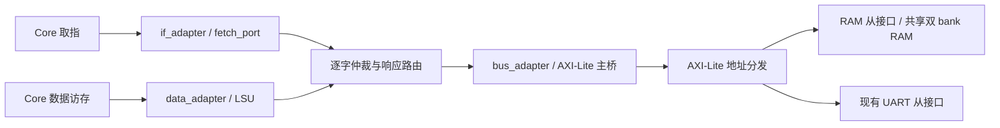

# RAM 接入共享 AXI4-Lite：实现与验证

本文保留首次接入版本（CPI 8.3503）的结构与证据。后续已优化主桥、取指交接和 RAM 读返回，当前实现及 CPI 2.0672 的验证见 [AXI-Lite 路径优化](axi_lite_optimization.md)。

2026-10-21：RAM 与 UART 已作为两个并列的 AXI4-Lite 从设备接入。取指和数据访问均经过共享 AXI-Lite 主桥，生产顶层不再实例化直连的 `dataram_banked`。Core 侧沿用 P1 请求/响应握手，本次没有继续修改 Core 的流水线逻辑，也未增加 Cache 或 MMU。

## 1. 实际连接



RAM 与 UART 是并列连接。当前 CPU 主桥一次处理一笔总线事务，因此两者的 CPU 访问仍按事务串行完成。UART 自身的串行收发独立运行；UART 寄存器访问得到 AXI 响应后，不必等待整个字符发送结束才能访问 RAM。

取指和数据请求可以分别保存在各自入口，仲裁器只允许一笔后备字事务在途，并锁定来源直到响应被接收。两个请求同时有效时轮流授权；下游背压期间也锁定已经提供的请求，防止后来到达的另一请求改变负载。Core 的四位请求 ID 由入口适配器保留，不作为 AXI4-Lite 的协议字段。

## 2. 模块职责

| 文件 | 职责 |
| --- | --- |
| `vsrc/top.v` | 保留 Core 端口，连接取指入口、LSU、仲裁、桥和两个从设备 |
| `vsrc/bus/fetch_mem_adapter.v` | 保存取指地址，将入口启动脉冲转换为后备字请求，保存返回结果 |
| `vsrc/core/lsu.v` | 字节/半字选择与扩展、写数据移位、字节掩码、跨字拆分和错误汇聚 |
| `vsrc/bus/mem_word_arbiter.v` | 两路请求仲裁、背压时请求锁定、响应来源路由 |
| `vsrc/bus/mem_req_adapter.v` | 复用 P1 适配器，连接入口及主桥的启动/忙接口与请求/响应接口 |
| `vsrc/bus/mem_to_axi_lite_bridge.v` | 复用现有 AXI4-Lite 主机状态机，将服务范围扩展到取指、RAM 与 UART |
| `vsrc/bus/axi_lite_interconnect.v` | 一个主接口到两个从接口的地址分发；独立保存 AW/W，保持 R/B 响应归属 |
| `vsrc/bus/axi_lite_subsystem.v` | 组合互连、RAM 从设备和 UART 从设备，供生产顶层及独立单测复用 |
| `vsrc/mem/axi_lite_ram_slave.v` | 原始 32 位字 RAM，支持字节写掩码、同步读取及 AXI 响应背压 |

现有 `dataram_banked.v` 保留供历史对照，当前顶层不再使用它。实际后备存储仍只有一份共享 RAM，指令读取可以观察到数据写入；原有自修改代码及 `fence.i` 测试继续运行。

## 3. 地址、存储格式与访问语义

| 地址 | 目标 |
| --- | --- |
| `0x80000000..0x8000ffff` | 64 KiB RAM |
| `0x10000000..0x1000000f` | UART 寄存器窗口 |
| 其余地址 | 互连返回 `DECERR`，不启动任一从设备 |

RAM 保留两个 bank，每 bank 8192 个 32 位字。字地址最低位选择 bank，其余低位选择 bank 内位置；继续加载原有 `bank0.hex` 和 `bank1.hex`，无需修改镜像生成工具。BRAM 数据在复位时保留，控制状态和测试出口 `tohost_value` 清零。

RAM/后备字接口要求 4 字节对齐，写入采用 `wdata[31:0]` 和 `wstrb[3:0]`。RAM 从设备遇到未对齐地址返回 `SLVERR`；CPU 的普通非对齐 load/store 由 LSU 转换，不直接发出未对齐字事务。

例如，`sb` 向字节偏移 1 写 `0xab` 时，LSU 输出 `wdata=0x0000ab00`、`wstrb=4'b0010`。跨字访问拆成两笔对齐事务：store 分别写入有效字节，load 合并两个字后再选择、扩展结果，最后只向 Core 返回一次响应。RAM 范围在第一拍前整体检查，越过 RAM 末尾的 store 不会先修改第一拍。跨字 store 不保证原子性，第一拍写成功后第二拍总线错误可能留下第一拍的写入。

UART 的子字访问映射到对应对齐寄存器字，写数据与掩码同步移位，读取后在 LSU 选择字节/半字；跨寄存器字的 MMIO 访问被拒绝。

`0x80001000` 保留为测试出口。RAM 字节写仍更新实际 RAM，测试出口按被写入的字节更新观察值；现有 ISA 测试的完整字写入退出方式保留。

错误能够从总线返回到 LSU/入口适配器，验证断言会报告错误。Core 对访存故障的精确 trap 尚未接通；当前非法地址测试在互连、RAM 和 LSU 单测中进行，不能据此声称已经完成 CPU 的精确内存异常支持。

AXI 协议依据：[Arm AMBA AXI and ACE Protocol Specification](https://developer.arm.com/-/media/Arm%20Developer%20Community/PDF/IHI0022H_amba_axi_protocol_spec.pdf)。RAM 和互连分别保存写地址、写数据，允许 AW/W 任意先后到达；返回有效后保持负载直到握手。

## 4. 验证命令与证据

从 `rtl/` 执行，依赖 Verilator、Python 3 和项目原有 RISC-V/LLVM 工具链：

```bash
# 编译两组新单测、原有适配器单测及带断言的完整 CPU，运行定向回归。
python3 tests/run_axi_ram.py \
  --suite focused --suite axi --suite pipeline --suite minstret

# 完整回归、性能和 CoreMark；复用上一步模拟器。
python3 tests/run_axi_ram.py --binary /tmp/axi_ram_verilator/Vtestbench \
  --suite all --suite bp --suite minstret --suite axi --suite perf --suite coremark \
  --wave test_results/axi_ram_uart_20261021.vcd

# 在三个本地适配边界注入 0..7 周期请求/响应等待。
python3 tests/run_axi_ram.py --binary /tmp/axi_ram_verilator/Vtestbench \
  --suite focused --suite axi --suite pipeline --suite minstret --suite all \
  --delay 7 --seed 493 --wave test_results/axi_ram_waits_20261021.vcd
```

驱动复用 `run_mem_handshake.py` 和现有统一回归工具，因此汇总文件仍以 `p1_run_*.json` 命名。驱动在仿真后恢复内存镜像，并与其他镜像测试共用锁。零额外等待指不启用测试延迟层，不表示 AXI 事务本身无延迟。该驱动的 CPU 仿真时限为 20 ms，分支测试为 200 ms；普通 `./run.sh bp` 的默认时限从 10 ms 调整为 100 ms。调用者仍可用 `BP_TIMEOUT_NS` 覆盖分支测试时限。

| 检查 | 结果及证据 |
| --- | --- |
| RAM/互连/UART 单测 | PASS；[日志](../test_results/axi_ram_unit_tb_20261021_110822_492898.log) |
| LSU 单测 | PASS；[日志](../test_results/lsu_unit_tb_20261021_110822_492898.log) |
| 5 项定向 ISA、RAM/UART 集成、4 项流水线、3 项计数器 | 全部 PASS；[清单](../test_results/p1_run_20261021_110829_400871.json) |
| UART + ISA，零额外等待 | 56/56 PASS，含 `fence_i`，无跳过；[汇总](../test_results/all_summary_20261021_110929_848602.txt) |
| 分支预测，零额外等待 | 6/6 PASS；[汇总](../test_results/bp_summary_20261021_110942_001755.txt) |
| 计数器，零额外等待 | 3/3 PASS；[汇总](../test_results/minstret_summary_20261021_110948_153823.txt) |
| CoreMark 一次迭代 | PASS，CRC 与测量计数校验通过；[汇总](../test_results/coremark_summary_20261021_110950_219933.txt) |
| 随机等待：5 项定向 ISA、RAM/UART 集成、4 项流水线、3 项计数器、56 项 UART/ISA | 69/69 PASS；[清单](../test_results/p1_run_20261021_111248_967201.json) |
| 生产顶层 lint | PASS，无警告；[日志](../test_results/axi_ram_lint_20261021_111250.log) |

RAM 单测包含 16 种写掩码、AW/W 三种到达顺序、B/R 背压、两个 bank、RAM 末尾、非法高位地址、未对齐字事务、复位中止、部分字节写 `tohost`、RAM 访问与 UART 串行发送同时进行。LSU 单测包含跨字合并、符号扩展、延迟响应、RAM 边界预检和第二拍错误。

`axi_ram_checks.svh` 在 CPU 回归中检查 AXI 通道稳定性、单个请求只选一个从设备、共享主桥事务配对、仲裁背压时字段稳定，并要求每个取指响应之前已经完成 AXI 读取。日志中的 `[AXI-PATH]` 给出实际发生的指令读取、RAM 数据读写、UART 读写次数。

波形：[零额外等待](../test_results/axi_ram_uart_20261021.vcd)、[GTKWave 配置](../test_results/axi_ram_uart_20261021.gtkw)、[随机等待](../test_results/axi_ram_waits_20261021.vcd)。从零等待波形提取的[前 64 次取指请求/响应时间](../test_results/axi_ram_uart_20261021.fetch.csv)显示：当前最短请求到响应为 6 个周期，连续取指最短接收间隔为 7 个周期。该延迟属于当前实现，不是 AXI-Lite 协议规定的固定延迟。

本机 `make simv_build` 仍因 VCS 许可证服务器不可用而失败，记录见 [构建日志](../test_results/axi_vcs_build_20261021_105448.log)。本次功能验证实际使用 Verilator 5.027。

## 5. 性能基线与后续 Cache 接入位置

同一工具链、CoreMark 一次迭代、相同 `start_time` 到 `stop_time` 区间，不注入测试等待：

| 版本 | mcycle | minstret | CPI |
| --- | ---: | ---: | ---: |
| 接入 AXI RAM 前的 P1 本地 RAM 路径 | 686309 | 287265 | 2.3891 |
| 当前共享 AXI4-Lite RAM 路径 | 2398761 | 287265 | 8.3503 |

证据：[本次修改前](../test_results/coremark_summary_20261021_105509_440290.txt)、[本次修改后](../test_results/coremark_summary_20261021_110950_219933.txt)。一次迭代用于短程比较，不满足 CoreMark 正式分数的运行时长要求。

当前明确存在性能回退：所有指令都需要经过 AXI 读取，取指和数据还共享单笔事务主桥；入口、字事务和 AXI 通道状态机之间也有交接延迟。本次完成的是总线访问基线，未实现命中旁路、多笔在途、突发传输或取指吞吐优化。

后续 ICache 放在取指入口到后备仲裁之间，DCache 放在 LSU 的可缓存字请求到后备仲裁之间；MMIO 继续旁路。Cache 读命中在本地返回，缺失补行与写直达才使用这条后备路径。此时再分别评估命中吞吐、补行带宽和取指队列，不能把 AXI 接入本身当成性能提升。
