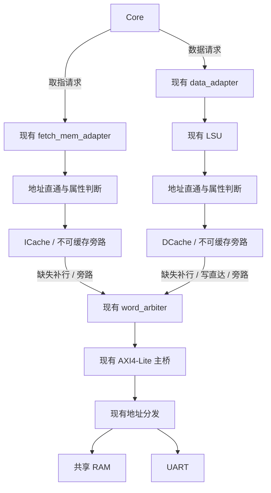

# ICache / DCache 接入计划（基于当前 AXI4-Lite SoC）

当前 DCache 实现采用写回、写分配，已使用独立的 I/D 物理字适配器接入 AXI4；
实际行为和验证入口见 [DCache 接入说明](dcache_cpu_integration.md)。下文保留最初写直达方案的规划记录。

更新日期：2026-10-23。C0 接口与属性已实现，见 [C0 实现与验证](c0_cache_boundary.md)；Cache 阵列和控制器从 C1 开始，尚待实现。原始设计讨论保留在 [早期方案](cache_mmu_plan.md)，当前已完成的主桥优化见 [实现与性能证据](axi_lite_optimization.md)。

实施顺序：复用当前接口 → 独立验证 ICache → 接入取指和维护 → 独立验证 DCache → 接入 LSU → 完成错误与系统验证 → 优化命中吞吐。AXI4 突发、MMU、多发射/乱序各为后续独立阶段。

## 当前起点

| 已完成部分 | 本轮处理 |
| --- | --- |
| Core 请求/响应握手、四位 ID、取指作废和返回缓冲 | 复用；Cache 放在字请求边界，不重复改造固定周期访存 |
| 数据适配器、LSU、字节掩码、跨字拆分、符号扩展 | 复用；Cache 只处理对齐字，LSU 保留原指令语义 |
| I/D 逐字仲裁、原生 AXI4-Lite 主桥、RAM/UART 两从设备 | 复用；首版补行由 8 笔单字事务完成 |
| 无争用取指最短接受间隔 1 周期 | 作为命中吞吐对照，避免新增 Cache 后默认为一定更快 |
| CoreMark 区间：593825 cycles / 287265 instructions，CPI 2.0672 | 使用同程序、工具链、测量区间作为性能基线 |
| 访存错误传播到模块接口 | Core 精确访存异常尚未接通，列入 C5，不能当作已经完成 |

当前基线证据：[零等待 82 项](../test_results/p1_run_20261021_122805_962400.json)、[随机等待 75 项](../test_results/p1_run_20261021_123101_660101.json)、[CoreMark](../test_results/coremark_summary_20261021_122919_503847.txt)。

## 接入位置

图中箭头表示请求方向，响应按相反方向返回；地址直通与属性译码放在各 Cache 之前。

ICache 插在 `fetch_port.mem_*` 与仲裁器来源 0 之间；DCache 插在 `data_lsu.req/rsp` 与仲裁器来源 1 之间。每侧的缓存与旁路由同一个控制器选择，首版不增加新的后备仲裁来源。

I/D 命中分别从各自阵列返回，不进入后备仲裁。I/D 缺失、写直达和不可缓存访问仍共享主桥。每个 Cache 最多处理一个未完成的上游字请求；两侧可以各自等待一条补行，后备仍只有一个未完成的字事务，按字轮流仲裁。这是首版的实现选择，不是 AXI4-Lite 协议的强制限制。

Core 四位 ID 继续由现有取指/数据适配器保存。当前字接口没有 ID；首版 Cache 沿用单请求的对应关系，不凭增加 ID 位数宣称支持多个并发请求。Core 当前的 MEM 等待策略仍保留，独立命中能力不等于 CPU 已经能每拍执行一条 load。

## 第一版配置

以下是本项目建议的起始配置，后续通过性能和资源数据调整。

| 项目 | 初版决定 | 原因或边界 |
| --- | --- | --- |
| 容量 | ICache、DCache 各 4 KiB 数据容量 | 不含 Tag、Valid、LRU 等元数据 |
| 相联度 | 两路组相联，每组一位 LRU | 先用无效路，两路都有效再替换 LRU 路 |
| 行大小 | 32 B，即 8 个 32 位字 | 与当前逐字接口对接，后续可用 8 拍 AXI4 突发 |
| 组数 | 每个 Cache 64 组 | 4096 / 2 / 32 = 64 |
| 地址组织 | 物理索引、物理标记（PIPT） | 给后续 MMU 留清晰翻译边界 |
| 地址宽度 | Core 有效地址 32 位；新 Cache 物理地址 34 位 | 当前零扩展；Tag 使用完整物理地址 |
| 数据阵列 | 每路 512 × 32 bit，同步读、按字节写 | 复用 `std_bram_tdp` 或封装为 `cache_data_ram`；复位不清整块数据 RAM |
| 缺失处理 | 每侧一个阻塞式请求；整行成功后返回 | 首版不做关键字先返回、多 MSHR 或预取 |
| DCache 写策略 | 写直达、不写分配，无 store buffer | 写成功才应答；没有 Dirty 与脏行写回 |
| 启停 | I/D 分别可关闭，模式在复位时固定 | 保留 00、10、01、11 四种对照模式；首版不支持运行中切换 |
| 后备总线 | 当前 32 位 AXI4-Lite | Cache 命中不经过它；缺失逐字补行 |

34 位 PA 时：`offset=addr[4:0]`，`index=addr[10:5]`，`tag=addr[33:11]`；行内字号为 `addr[4:2]`。新物理地址接到现有 32 位仲裁/AXI 接口前，必须检查高位和完整地址合法性，再取低 32 位；禁止静默截断产生地址别名。可通过边界适配器保留当前主桥的 32 位端口，无需现在重写整个 AXI 后端。

34 位 PA 为未来 Sv32 预留，不表示本轮实现 MMU。[RISC-V Supervisor 规范](https://docs.riscv.org/reference/isa/priv/supervisor.html) 描述了 Sv32 的 32 位 VA 到 34 位 PA 转换。

## 分阶段计划表

| 阶段 | 主要任务与交付 | 完成条件 |
| --- | --- | --- |
| C0 接口与属性（已完成） | 定义 Cache 字接口、维护握手、PA 直通/检查、缓存属性；预留 I/D 独立配置与四模式验证入口，本阶段仅 00 可运行 | 两 Cache 关闭时维持现有功能和零额外周期；非法高 PA 不回绕，UART/tohost 不触发补行 |
| C1 ICache 独立模块 | 两路 Tag/Valid/LRU、同步数据 RAM、命中、8 字补行、替换、失效、旁路及错误响应 | 单测覆盖冷缺失、重复命中、冲突替换、响应背压、每个补行字的错误、复位中断 |
| C2 ICache 接入 Core | 在 `fetch_port` 后接入；保留返回缓冲和 killed 处理；实现 `fence.i` 维护等待与完成后重定向 | I 开/D 关，通过取指、分支、背压和自修改代码测试；I 缺失时后端仍能前进，无维护死锁 |
| C3 DCache 独立模块 | load 命中/补行；store 命中写直达并更新字节、store 缺失只写 RAM；旁路与错误处理 | 对参考内存逐字节比对；所有写掩码、替换、部分写、写失败、补行失败均正确 |
| C4 DCache 接入 LSU | 在 LSU 字接口后接入；整合 RAM 缓存与 UART/tohost 旁路；验证 I/D 两侧协作 | D-only 和 I+D 模式下，字节/半字/字、跨字/跨行、MMIO、tohost 正确；I/D 补行公平且无丢响应 |
| C5 维护与精确错误闭环 | 完成取指/load/store access fault、故障 PC/地址保存、错误指令不提交；复查 FENCE/FENCE.I 与在途请求 | 被冲刷的错误取指不触发 trap；较老数据错误优先；失败 load 不写 rd，较年轻指令无副作用；维护后无旧行重新安装 |
| C6 四模式系统验收 | Cache 00/10/01/11 全组合；定向 → 子系统 → ISA/UART/BP/计数器/CoreMark；零等待和随机等待 | 适用回归全部通过，`fence_i` 不跳过，ISA `tohost=1`，CoreMark CRC 正确，日志和波形留档 |
| C7 命中吞吐与性能 | 优化 ICache 查询/返回重叠；测量 D 命中时 LSU/适配开销，按瓶颈单独优化；统计命中、缺失、总线字数、CPI 和资源 | 热命中且无背压时 ICache 目标为每周期接收/返回一个请求；给出四模式同窗口比较，不预设 CPI 必然降低 |
| C8 可选 AXI4 后端 | 将补行后端改为真正的突发接口；RAM 支持 burst，UART 通过单字适配保留 Lite；独立验证 LAST、响应归属和错误 | 32 B 行用 8 拍突发补齐，四模式行为保持；以补行时延和端到端性能决定是否保留 |

C0～C6 是首版功能验收范围；C7 单独证明吞吐和性能。C8 不阻塞开始实现 Cache。每阶段应保持关闭新模块的基线模式可运行，阶段交付按可独立复查的变更拆分，不同时首次接入 MMU、写回和多发射。

## 各阶段必须固定的行为

### C0：缓存属性和原有接口

| 完整物理范围 | 属性 | 请求行为 |
| --- | --- | --- |
| `0x80000000..0x8000ffff`，排除测试出口行 | 普通可执行 RAM | 取指/load 可以缓存；store 按写直达策略 |
| `0x80001000..0x8000101f`（当前 32 B 行） | 测试出口所在 RAM 行 | 两侧整行不可缓存，仍由 RAM 服务；仅实际 store 写入更新 tohost |
| `0x10000000..0x1000000f` | UART MMIO | 仅数据访问，不缓存、不补行、不预取，读写副作用各发生一次 |
| 其余或 PA 高位不合法 | 非法 | 返回错误，禁止访问低位别名 |

测试出口行边界由 `TOHOST_ADDR`、`LINE_BYTES` 计算，不硬编码为只排除一个字。旁路采用真正的逐字访问，不先填入 Cache 再宣称旁路。属性译码在查询/分配前完成，并检查整行属性一致性。

保留现有请求/响应稳定性规则：被阻塞的请求不得撤回或改变字段，响应被阻塞时保持数据/错误；接受一次请求只完成一次响应。补行和旁路状态机持续工作，不用 CPU stall 作为使能。

当前 `axi_ram_checks.svh` 要求每个取指响应前完成一次 AXI 读。启用 ICache 后应改为关联「命中返回」或「成功补行/旁路返回」，并保留后备通道配对和稳定性断言；不直接删除整套检查。复用驱动时，新增 `run_cache.py` 和 `cache_checks.svh`，使未缓存基线断言只在相应模式启用。

### C1～C2：ICache 与前端

查询保存请求地址、命中信息和返回槽；补行使用保存的行基址与字号，不能读取已经变化的实时 PC。无效路优先替换，准备填入的 victim 在第一笔写阵列前保持无效；8 个字全部成功后才安装有效行。任一拍失败则不安装部分行，并返回一次错误。

`fetch_mem_adapter` 的返回缓冲继续保留：即使 Core 因数据访问暂停，也要能先接收取指返回，释放后备仲裁器给数据访问。普通分支由 Core 作废指令归属，Cache 已开始的补行可以完成；对应旧指令仍经握手被吸收，不送入有效流水线。

`fence.i` 必须扩展成维护事务，而非继续只产生一拍前端 flush：

1. 保存维护状态，只启动一次；阻止新取指，把前端在途项标为作废并继续接收返回。
2. 等待更早数据读写完成，排空旧取指、旧补行和返回缓冲。
3. 清除 ICache 全部 Valid；扫描期间不接受正常查询。
4. 收到维护完成后，清空相关前端状态，执行一次预测器失效和 PC+4 重定向，再继续取指。

维护启动不能仅依赖 `ex_fire` 或 `bp_update_valid`：如果维护等待本身暂停 EX，就可能永远没有启动事件。采用维护请求已发送/完成状态管理，允许维护与后备存储在 Core 暂停时继续运行。前端排空也不能等待因为维护而暂停的 IF2 自行腾空，必须通过作废标记使旧响应能够被吸收。

写直达且无 store buffer 的版本，只需确认更早写已完成，再维护 ICache；不要求每次 `fence.i` 清空 DCache。将来改为写回后，要先增加脏数据 clean 与写回完成等待。上述是本项目选择的保守维护实现，目标是满足 [Zifencei](https://docs.riscv.org/reference/isa/unpriv/zifencei.html) 对更早写入与后续取指的同步要求。

### C3～C4：DCache 与 LSU

| 请求 | 命中 | 缺失 |
| --- | --- | --- |
| load | 返回原始对齐字 | 读完整行、成功安装后返回所需字 |
| store | 写后备 RAM；确认成功后按 `wstrb` 更新命中行，再完成响应 | 只写后备 RAM；不分配行，成功后响应 |
| 不可缓存访问 | 不查询/分配 Cache，直接逐字访问后备 | 同左 |

写失败保守失效相关命中行，返回错误，不能返回成功；store 等待期间不接受另一条可能观察到不一致内容的数据请求。跨字和跨行由原 LSU 拆分成多个字事务，DCache 不再重复做符号扩展或拼接。

写直达减少错误恢复和自修改代码的复杂度，但每次 store 仍访问共享主桥，因此首版仍可能存在取指缺失与 store 的争用。若程序主要受写流量限制，再另立写回/写分配、Dirty、写回失败恢复与 clean 维护任务。

### C5～C6：错误与验证

Cache 后端错误沿响应传到前端/LSU，保存原始指令 PC、有效地址及必要的失败子访问地址。取指故障与请求归属一起进入流水线，若被更老分支作废则丢弃；数据故障在安全的异常位置处理，不能让较年轻分支、CSR 或 store 越过。故障指令不作为正常指令计入退休。

跨字 store 延续现有边界预检，但不承诺原子性：第二个字发生总线错误时，第一个字可能已经写入。精确报告故障不等于回滚已完成的写拍。

必须新增的定向覆盖包括：

- 相同行重复访问、两路填满、第三条同组行替换、32 B 边界、RAM 末尾及 PA 高位别名。
- 同周期 I/D 命中、双侧同时缺失、某侧长期请求时的公平性、Core 背压时另一侧补行仍可推进。
- 部分字节写命中、store miss 不分配、跨行 load/store、MMIO 连续读写、tohost 整行旁路。
- 分支遇到受阻取指、旧补行完成后作废返回、自修改代码、`fence.i` 遇到在途补行与缓存返回。
- 补行第 0～7 字分别出错、写错误、复位中止、错误路径取指被冲刷、access fault 的 PC/地址/优先级。

每个 Cache 使用参考内存/计分板验证，随机等待覆盖请求和响应两端，返回背压期间检查字段不变。完成模块定向测试后再跑子系统及完整回归，证据保存至 `rtl/test_results/`；不使用跳过 `fence_i` 的方式完成验收。

### C7：性能验收

当前后备 RAM 取指已可每周期接受一次。功能版若查询/响应需要多拍，Cache 可能先增加开销；只有正确性、命中吞吐、缺失代价和命中率一起测量后，才能判断是否改善 CPI。功能版结果应如实记录，性能版再优化，避免把同步 BRAM 的一拍读出当成完整 Cache 的吞吐保证。

至少记录以下指标，并对 00/10/01/11 四模式使用同一程序、编译选项和性能区间：

| 指标 | 计数口径 |
| --- | --- |
| mcycle、minstret、CPI、CoreMark CRC | 比较同一 start_time～stop_time 区间；现基线 CPI 2.0672，一次迭代仅是短程比较 |
| I 命中/缺失 | 按被接受的可缓存取指请求计数，作废取指是否计入需保持一致 |
| D 读命中/缺失、写命中/缺失 | 按 LSU 的可缓存字请求分别统计；与架构 load/store 指令数区分 |
| 旁路、补行读字、写直达、后备等待 | MMIO 与 tohost 不混入普通 Cache 命中率；每拍握手只计一次 |
| 前端缺数、数据等待、仲裁等待 | 说明重叠；若求和，使用互斥停顿桶 |
| Fmax、LUT/FF、BRAM | 有综合环境时记录；周期减少不能直接宣称实际运行频率提高 |

真实一拍 RAM 与额外延迟内存分开报告；不能以人为增加等待后的收益代替当前硬件条件下的收益。首个吞吐目标是热命中、响应可接受时 ICache 可连续每拍处理一个请求；LSU/数据适配器的交接开销如需改动，另做原生数据握手优化并回归乘除法/转发。

## 建议文件与修改范围

| 新增或复用 | 文件 | 用途 |
| --- | --- | --- |
| 新增 | `vsrc/cache/icache.v`、`dcache.v` | 独立两路 Cache 控制器、命中与替换 |
| 新增 | `vsrc/cache/cache_data_ram.v` | 同步数据阵列封装，保留 BRAM 推断 |
| 新增 | `vsrc/cache/cache_refill_word.v` | 复用两份逐字补行引擎，各自记录行地址、字号和错误 |
| 新增 | `vsrc/mem/mem_attr_decode.v`、`addr_translate_bypass.v`、`phys_word_adapter.v` | 物理属性、32→34 位直通和合法 PA 接入当前 32 位后备接口 |
| 修改 | `vsrc/top.v`、`vsrc/core/riscv_core.v`、`ex.v`、`csr.v` | Cache 实例和配置、维护等待、故障归属与精确异常所需控制 |
| 复用并按验证调整 | `fetch_mem_adapter.v`、`mem_req_adapter.v`、`lsu.v`、`mem_word_arbiter.v`、`axi_lite_master.v` | 现有请求归属、数据语义和逐字后备路径 |
| 新增 | `tests/icache_unit_tb.sv`、`dcache_unit_tb.sv`、`cache_checks.svh`、`run_cache.py` | 模块计分板、模式相关断言和回归驱动 |
| 新增 | `vsrc/instrom/cache_tests/` | 缓存冲突、跨行、自修改、维护、故障端到端用例 |

这些文件名是计划中的拆分建议，不表示当前已经存在对应模块。继续使用共享 RAM 与当前镜像工具，不新增一份独立指令后备存储；活动实现只修改 `rtl/`。

## AXI4、MMU 与多发射后续路线

| 后续任务 | 开始条件与必要改造 |
| --- | --- |
| C8 AXI4 突发 | C0～C7 有可复现对照后，按带宽需求决定；修改补行后端，使其发出一条行事务并识别 RLAST，不能仅给现有逐字请求增加 AXI4 端口名 |
| 写回 DCache | 写直达版本稳定，且测量证实 store 流量是瓶颈；增加 Dirty、victim 保存、失败恢复、写回与 FENCE.I clean |
| Sv32 MMU | Cache 功能验收后，增加 ITLB/DTLB、PTW、权限/页故障、相关特权状态和 SFENCE.VMA；物理 Cache 接口保留 |
| 多发射/乱序 | 再扩展取指宽度/队列、发射和提交；乱序另需重命名、ROB、Load/Store Queue、提交授权与恢复，之后再评估非阻塞 Cache |

未来 MMU 不能只替换一个地址连线：当前取指适配器/LSU 基于有效地址做的 RAM 范围检查要移到物理属性检查；跨页子访问分别翻译，不能由第一个 PA 直接加出第二个 PA。页表遍历使用物理访问通路，且等待翻译的请求不能占死 PTW 所需的缓存资源。指令 PC 和故障 VA 继续保留在 Core/LSU。

AXI4 阶段可以先保持单条突发在途；多个在途事务属于额外吞吐工作，需要请求记录与响应归属。完整 AXI4 接 RAM，UART 保持 AXI4-Lite 并通过适配器处理单字访问；首版 Cache 不依赖这些升级。
